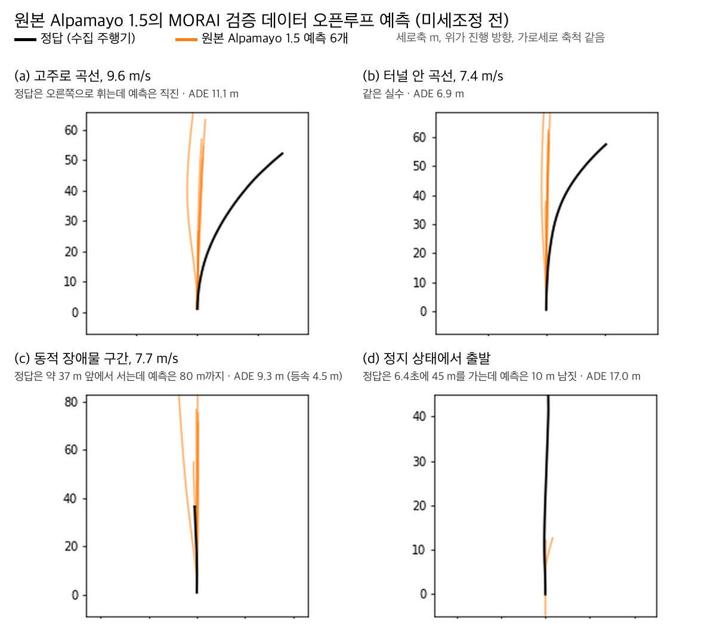
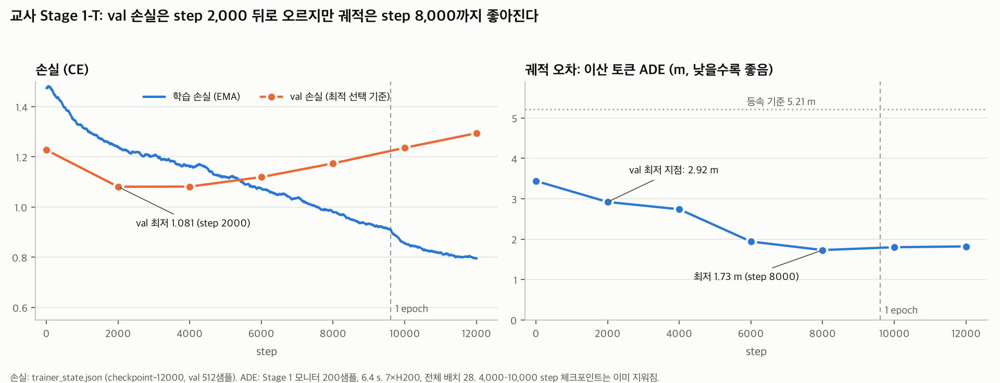

# WoWmayo: Distilling Alpamayo 1.5 into a 10 Hz Driving Model for MORAI K-City

**와우마요(WoWmayo)** 는 NVIDIA Alpamayo 1.5(10B)를 MORAI 시뮬레이터 K-City에 적응시킨 뒤, RTX 5080 한 장에서 10 Hz로 도는 E2E 주행 모델로 증류한 개인 연구다. 2026 대학생 AI·S/W 모빌리티 경진대회 미션을 기준으로 삼았다. 대회 출전은 동아리의 룰베이스 ROS 스택으로 했고, 이 저장소는 그와 병행한 연구 코드다.

- 개발기 연재: [와우마요 개발기 (velog)](https://velog.io/@taeyun_kim/series/와우마요-개발기)
- 관련 글: [Alpamayo-R1 논문 읽기](https://velog.io/@taeyun_kim/피지컬AI-논문-리뷰-Alpamayo-R1) · [AutoPi](https://velog.io/@taeyun_kim/피지컬AI-AutoPi-자율주행-VLA모델-개발하기) · [대회 출전기](https://velog.io/@taeyun_kim/2026-ai-sw-mobility-competition) · [Lanelet2와 특권모델](https://velog.io/@taeyun_kim/Lanelet2와-특권모델-개발)

## Abstract

특권 주행기로 K-City 정상 주행 69.5시간을 모았다. 원본 Alpamayo 1.5는 이 데이터의 검증 세트에서 오픈루프 ADE 5.29 m로 등속 기준선(5.14 m)보다 나빴다. LiDAR를 붙여 MORAI로 미세조정한 교사 T\*는 ADE 1.311 m였다. 학생은 Qwen3-VL-4B에 Alpamayo의 action expert를 이식한 약 7.1B 모델로, 층별 KV 증류와 2단계 학습으로 교사 1.419 m 대비 1.489 m(같은 500샘플)에 도달했다. QAD로 4.749비트 NVFP4/FP8 혼합 정밀도에 올린 납품본은 ADE 1.511 m(s2 대비 1.0148배), RTX 5080 추론 p50 96.4 ms였다. 첫 폐루프에서 K-City 한 바퀴를 완주했지만, 걷는 보행자·출발 대기·적신호 정지에서 학습 데이터의 결손이 드러났다. 재수집(R2)과 재라벨 후 미세조정한 버전은 같은 조건 4바퀴를 모두 완주했다. 동적 장애물 앞 정지는 오프라인 onset 제동률 2.9 → 78.7 %까지 올렸으나 폐루프에서는 확인하지 못했다.

## 1. Problem

| 항목 | 조건 |
| --- | --- |
| 추론 GPU | RTX 5080 (16 GB) |
| 목표 주기 | 10 Hz (스텝당 100 ms), 설계 목표 p99 80 ms |
| 센서 | 카메라 4대 (Front, Left, Right, Cam7), VLP16 LiDAR, GPS, IMU |
| 출력 | 6.4초 궤적, 0.1초 간격 64점의 가속도 a와 곡률 κ |
| 환경 | MORAI SIM, K-City, 아이오닉5 |

Alpamayo 1.5는 실제 도로 데이터로 학습한 10B 모델이라 두 가지가 맞지 않는다. 크기는 5080의 10 Hz 예산을 넘고, 도메인은 MORAI의 렌더링·차량·센서와 다르다.

| 오프라인 (검증 1,000샘플) | ADE (m) | FDE (m) |
| --- | ---: | ---: |
| 등속 기준선 | 5.14 | 12.77 |
| 원본 Alpamayo 1.5 | 5.29 | 15.41 |



*미세조정 전 원본 Alpamayo 1.5. 검정이 정답, 주황이 예측 6개. 곡선에서 직진하고, 서야 할 곳에서 달린다.*

그래서 문제를 둘로 나눴다. 교사를 먼저 MORAI에 적응시키고, 적응된 교사를 5080에 맞는 학생으로 증류한다.

## 2. Pipeline


단계 사이에는 숫자 관문(gate)을 두었다. 교사는 원본 1.5의 ADE를, 학생 s1은 교사 대비 ADE 비율 1.5를, QAD는 s2 대비 1.25배를 넘으면 멈춘다.

## 3. Data

### 3.1 수집

동아리 ROS 스택에 시뮬레이터 GT(자차 상태, 신호 상태, 객체)를 넣은 특권 주행기로 수집했다. 경로 위 정지거리 안의 GT 객체에는 전제동(AEB)을 걸었다. GT는 운전과 정답 생성에만 쓰고, 학생 입력은 센서 원본이다.

코스를 미션별 7개 셀로 나누고 셀마다 무작위화 축과 목표 시간을 정했다. 날씨 2종 × 시각 3종을 모든 셀에서 고르게 맞췄고, 에피소드의 30 %에 조향 노이즈를 넣어 복구 데이터를 만들었다(노이즈 구간은 마스킹).

| 셀 | 내용 | 확보 / 목표 (h) |
| --- | --- | ---: |
| C0 | 출발·차로 유지·곡선 | 12.1 / 4 |
| C1 | 신호 교차로 | 9.9 / 8 |
| C2 | 정적 장애물 | 9.0 / 7 |
| C3 | 동적 장애물 | 13.5 / 7 |
| C4 | 회전교차로 | 6.4 / 5 |
| C5 | 고주로 합류 | 11.3 / 5 |
| C6 | 터널 (GPS 음영) | 7.3 / 4 |

에피소드 1,289개, 녹화 약 84시간 중 정상 69.5시간.

### 3.2 정답 궤적과 시간축

- **유효성**: `traj_ok`는 [t, t+6.4 s] 안에 감점 이벤트도 노이즈 주입도 없을 때만 참이다. 필터는 삭제가 아니라 라벨로 남겨, 임계값이 바뀌면 다시 계산한다.
- **정지 프레임**: 정지 유지 구간은 솎고 출발 순간은 남겼다. 초록불 직전의 빨간불 프레임처럼 미래 출발을 담은 행은 학습에서 뺐다.
- **시간축 τ**: 비동기 수집 중 시뮬레이션 시간은 벽시계보다 느리게 흘렀다(본 수집 RTF 0.81–0.84). 벽시계로 자른 6.4초 정답에는 약 5.3초 분량의 움직임만 담긴다. 이동 거리와 GT 속도로 구간별 비율을 구해 시뮬레이터 시간축 τ를 사후 복원하고, 카메라·이력·LiDAR·정답을 모두 τ 눈금에서 골랐다. 회전 기준 독립 측정과 약 ±2 % 안에서 맞았다.

### 3.3 추론 라벨 (CoC)

Alpamayo의 Stage 1-C용 CoC 라벨은 VLM 단독으로 만들면 MORAI 시설물을 공사로 부르는 등 원인을 환각했다. 결정은 GT에서, 원인은 화면에서 실제로 보이는지로 정하는 가시성 기반 라벨러로 바꿨다.

| 항목 | 값 |
| --- | --- |
| 에피소드 / 키프레임 | 1,365 / 18,517 |
| 원인이 화면에서 확인된 CoC | 13,749개 (문장 형태 877종) |
| 결정–GT 일치 (종 / 횡) | 98.9 % / 99.1 % |
| 공식 3단계 검사 전부 통과 (무작위 120개) | 94.2 % |

## 4. Model

| 구성 | 교사 T\* | 학생 (WoWmayo) |
| --- | --- | --- |
| VLM | Alpamayo 1.5 백본 (Cosmos-Reason2-8B) | Qwen3-VL-4B |
| action expert | 1.5 expert (36층, 약 2.28B) | 교사 expert 이식 |
| 카메라 ViT | Alpamayo ViT (27층, 1152) | Qwen3-VL-4B ViT (24층, 1024) |
| LiDAR | BEV 전용 ViT 사본 | 같음 |
| 크기 | 약 11.7B | 약 7.1B |

Qwen3-VL-4B는 Alpamayo 1.5 백본과 층 수·층당 KV 모양이 같아, 교사 expert를 그대로 이식하고 학생의 층별 K, V를 교사에 투영 없이 맞출 수 있었다. 이를 위해 교사와 학생의 입력 토큰 열(뷰, 프레임, 해상도, 프롬프트)을 1:1로 맞췄다.

| 증류 | 대상 |
| --- | --- |
| 행동 | 교사 궤적 샘플, expert 속도장 |
| 특징 | LLM 층별 K, V, ViT 토큰 |
| 가중치 | expert 이식 |

학생 expert 손실은 GT를 주 손실로, 교사 속도장을 보조로 썼다.

```text
L = L_FM(GT (a, κ), traj_ok) + λ · ‖v_student − v_T*‖²    (λ: 1 → 0.2)
```

**입력.** 카메라 4대 × 과거 4프레임. 해상도는 신호등 판독 실험(신호등 앞 프레임 536장)으로 정했다.

| 카메라 | 원본 | 입력 | 토큰 × 4프레임 |
| --- | --- | --- | ---: |
| Front | 1280×720 | 448×256 | 448 |
| Left / Right | 640×480 | 352×256 | 704 |
| Cam7 (근거리 신호) | 640×480 | 256×192 | 192 |
| 합 | | | 1,344 |

자차 이력 16점(τ 0.1 s), 항법 텍스트, 프레임별 실제 상대 시각 텍스트를 1.5 형식 그대로 넣었다. 프리픽스는 1,725토큰. 추론 시 CoC 텍스트는 생성하지 않는다(5080에서 4B로 40토큰 디코딩 시 약 190 ms, 추정).

## 5. Training

### 5.1 교사 T\*

[NVlabs/alpamayo-recipes](https://github.com/NVlabs/alpamayo-recipes)의 1.5 SFT 단계를 따랐다.

| 단계 | 데이터 | 손실 | 학습 부위 |
| --- | --- | --- | --- |
| step 2 | 2,000 step | 이산 궤적 CE | LiDAR ViT·merger (0.58B) |
| Stage 1-T | 모든 정상 프레임 | 이산 궤적 CE | VLM 전체 + LiDAR 경로 |
| Stage 1-C | CoC 키프레임 9,624개 | CoC + 궤적 CE | 같음 |
| Stage 2 | 모든 정상 프레임 | GT (a, κ) flow matching | expert만 (fp32) |

val CE와 궤적 ADE가 반대로 움직였다. CE 최선(step 2,000)이 궤적은 가장 나빴다. 체크포인트 선택을 궤적 ADE 기준으로 바꾸고, 학습 전에 정지 규칙(2 % 미만 개선 3회 연속이면 멈추고 짧게 감쇠)을 걸었다.



| 오프라인 (val 1,000샘플, expert 궤적) | ADE (m) | FDE (m) | minADE (m) |
| --- | ---: | ---: | ---: |
| 등속 기준선 | 5.143 | 12.765 | — |
| 원본 Alpamayo 1.5 | 5.29 | 15.41 | 2.66 |
| **T\*** | **1.311** | **3.865** | **0.679** |

LiDAR를 꺼도 ADE는 1.311 → 1.323 m로 거의 같았다. 모델은 Stage 1-T 초반부터 LiDAR를 거의 쓰지 않았다.

### 5.2 학생

| 단계 | 학습 부위 | 손실 | 결과 |
| --- | --- | --- | --- |
| s1 | VLM (expert 고정) | KV 증류 + 고정 expert flow matching + 궤적 CE + ViT 특징 증류 | ADE 1.761 m (step 9,600) |
| gate | — | 학생 KV 위 고정 expert ADE / 교사 | 1.78 / 1.35 = 1.32 (기준 1.5) |
| s2 | VLM + expert | s1 손실 + expert 속도장 증류 | ADE 1.489 m (교사 1.419 m, 같은 500샘플) |

## 6. Quantization and Deployment

- **정밀도 배치**: 카메라 ViT는 FP8, LLM·expert 선형층은 NVFP4 위주. 5080(sm_120) FP4는 cuBLASLt와 FlashInfer `b12x` 커널을 썼다.
- **ViT 캐시**: 과거 프레임의 ViT 출력을 재사용해 매 스텝 새 이미지만 ViT를 통과시킨다. 캐시 결과는 전체 재계산과 비트 단위로 같았다.
- **벤치마크**: 4프레임 × Euler 10 step 한 스텝이 설계 그대로는 137 ms, 커널과 캐시를 적용해 89 ms.
- **QAD**: 비트 예산 4.75로 민감한 층만 FP8에 남겼다. 탐색 결과 4.749비트, 600층 중 NVFP4 454 / FP8 146(이 중 96층은 카메라 ViT). LLM·expert에서 FP8은 50층, 가중치의 7.1 %.

| 모델 (같은 500샘플) | ADE (m) | 비율 |
| --- | ---: | --- |
| 교사 T\* | 1.419 | — |
| s2 학생 | 1.489 | — |
| QAD 학생 (납품) | 1.511 | s2 대비 1.0148 (기준 1.25) |

| 추론 (RTX 5080, 첫 폐루프) | p50 | p95 | 최대 | 100 ms 초과 | VRAM |
| --- | ---: | ---: | ---: | ---: | ---: |
| 납품본 | 96.4 ms | 104.0 ms | 126.5 ms | 16.8 % | 7,863 MiB |

## 7. Closed-loop Evaluation

**프로토콜.** K-City 전 구간을 무작위 시나리오로 돈다. 체크포인트 구간마다 날씨와 시각을 바꾸고, 오래 멈추거나 도로를 벗어나면 직전 체크포인트로 복귀시킨다. 점수는 주행 시간 + 감점 + 복귀 × 15 s(대회 방식). 시뮬레이터가 실시간보다 느릴 때도 시뮬레이션 시간 기준 10 Hz로 추론을 모사했다.

**첫 납품본.** 한 바퀴를 완주했다(463.4 s + 감점 110 s + 복귀 15 s = 588.4 s, 감점은 전부 차선). 실패는 학습 데이터의 결손으로 거슬러 올라갔다.

| 데이터 결손 | 폐루프에서 나온 행동 |
| --- | --- |
| 수집 데이터의 보행자가 걷지 않음 | 건너는 보행자를 본 적 없음 |
| 수집 에피소드 출발 전 약 7.6 s 정지 | 출발 지점에서 52.6 s 대기 |
| 곡선 큰 이탈의 복구 사례 부족 | 곡선에서 차선 중심 4 m 이탈 후 복귀 못 함 |
| 로터리 이음매에서 수집 주행기가 기어감 (98.7 %) | 차 없는 진입부에서 머뭇거림 |

## 8. Fine-tuning Rounds

| 버전 | 출발점 | 변경 | 손실 |
| --- | --- | --- | --- |
| R2 ft | s2 | 걷는 보행자 재수집(R2: 892 에피소드, 6.87 sim-h) + 출발 대기 재라벨(54,285행), 3,251 step | 정답만 |
| r2stop | R2 ft | 동적 정지 25 % + 적신호 25 %, 1,000 step | 정답만 |
| dynbal | R2 ft | 합성 정지 라벨 + 반대 예시 + 정적 회피, 정제 replay, 1,000 step | 정답만 |
| lwf | R2 ft | 근거리 돌출 장면 + 라벨 정리, R2 ft 고정 사본을 교사로(LwF), 2,000 step | 교사 + 정답 |

| 버전 | 겨냥한 지표 (오프라인) | 대가 |
| --- | --- | --- |
| R2 ft | 동적 ADE −19 % | 일반 ADE +34 % |
| r2stop | 적신호 정지 ADE 4.54 → 2.35 | 곡선 횡오차 0.54 → 0.98 m |
| dynbal | 관문 ADE R2 ft 대비 0.976 | 감속 행 종방향 이력 의존 1.65배 |
| lwf | 돌출 onset 제동률 2.9 → 78.7 % | 곡선 ADE +0.5, 일반 오제동 +2.3 %p |

같은 시드, 저·고밀도 교대 4바퀴의 점수(초, 낮을수록 좋음):

| 버전 | 바퀴 1 (저) | 바퀴 2 (고) | 바퀴 3 (저) | 바퀴 4 (고) | 완주 |
| --- | ---: | ---: | ---: | ---: | ---: |
| 첫 납품 | 시간초과 | 시간초과 | 시간초과 | 시간초과 | 0/4 |
| R2 ft | 1078 | 407 | 963 | 615 | 4/4 |
| r2stop | 시간초과 | 583 | 422 | 555 | 3/4 |
| dynbal | 425 | 484 | 400 | 848 | 4/4 |
| lwf | 623 | 399 | 1079 | 시간초과 | 3/4 |

같은 버전 안에서도 바퀴별 점수가 두 배 넘게 갈려(R2 ft 407–1078), 4바퀴로는 R2 ft와 dynbal의 우열을 가를 수 없다.

## 9. Discussion

- **오프라인 지표와 폐루프의 불일치.** CE 최선이 궤적 최악이었고, 관문을 1.0148로 통과한 납품본이 출발 대기와 곡선 이탈을 보였다. 일반 ADE가 34 % 나빠진 R2 ft가 폐루프 완주는 늘렸다. 오프라인 지표에는 종방향 오차의 부호가 없어 "늦게 선다"와 "일찍 선다"를 가리지 못했다. 버전 판단은 폐루프 영상으로 했다.
- **정답의 결함.** 실패 대부분은 수집 주행기와 라벨 규칙에서 왔고, 모델은 그것을 충실히 배웠다. 동적 정지 정답의 82 %가 원인이 보이기 전 감속이었고 AEB는 마지막 순간 제동이었다. 여섯 가지 결함 중 다섯은 학습 후에야 드러났다.
- **좁은 데이터 미세조정.** 미세조정마다 혼합 비율에서 빠진 능력이 깎였다(R2 ft의 적신호 정지, r2stop의 차선 추종). dynbal의 비율 유지와 lwf의 LwF는 이 결과에서 나왔다.

### Limitations

| 문제 | 상태 |
| --- | --- |
| 움직이는 보행자 앞 정지 | 오프라인 onset 제동 78.7 %, 폐루프 미검증 |
| lwf의 정적 장애물 앞 정지 | 원인 미규명 |
| 로터리 진입 | 라벨 원인 확인, 수정 데이터로 재학습 전 |
| 근거리·가림 돌출 | 근거리 돌출 396사건 중 52.5 %는 첫 행부터 최대 감속으로도 못 섬 |
| 고주로 후방 | LiDAR BEV 후방 20 m, 재학습·QAD 필요 |
| PPO | 계획만 |

## 10. Repository

| 경로 | 내용 |
| --- | --- |
| `train/morai_vla/` | 데이터셋(τ 프레임 선택, BEV), 교사 `TeacherVLA`, 학생, 증류 손실, QAD, 조기 종료 |
| `train/configs/`, `train/scripts/`, `train/tests/` | 단계별 설정, 실행·평가 스크립트, 테스트 |
| `train/dagger/`, `train/rl/` | 섀도 DAgger, PPO 코드 |
| `train/logs/`, `train/outputs/` | 학습·평가 로그와 그림 |
| `tools/step0/` | 수집 bag → 학습 테이블 변환 |
| `tools/coc_labeler/`, `tools/coc_pilot/` | 가시성 기반 CoC 라벨러, VLM 라벨링 시험 |
| `tools/scorer/` | 대회 판정 재현 채점기, 라벨 검사기 |
| `tools/start_relabel/` | 출발 대기 재라벨 |
| `tools/vast/` | 클라우드 GPU 학습 운영 스크립트 |
| `reports/` | 분석 그림과 검수 자료 |
| `MODEL_PLAN.md`, `DATA_PLAN*.md`, `DAGGER_PLAN.md`, `RL_PLAN.md`, `PPO_PLAN.md` | 설계 문서 |
| `VAST_SETUP.md`, `RUNPOD_SETUP.md` | 학습 환경 구성 |

교사 학습 코드의 상세는 [train/README.md](train/README.md)에 있다. 수집 데이터, 체크포인트, 엔진은 저장소에 포함하지 않는다.

## 11. Dependencies

- [NVlabs/alpamayo-recipes](https://github.com/NVlabs/alpamayo-recipes) (커밋 `2e907da`)와 그것이 고정한 `alpamayo_r1`
- Alpamayo 1.5-10B, Qwen3-VL-4B 가중치
- MORAI SIM (K-City)
- FlashInfer (`b12x`), cuBLASLt (CUDA 13)

모델 가중치와 시뮬레이터는 각 제공자의 라이선스를 따른다.
