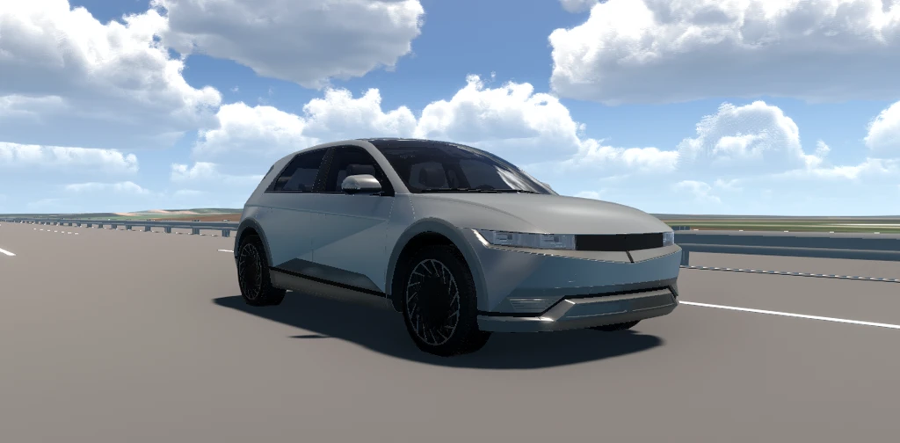
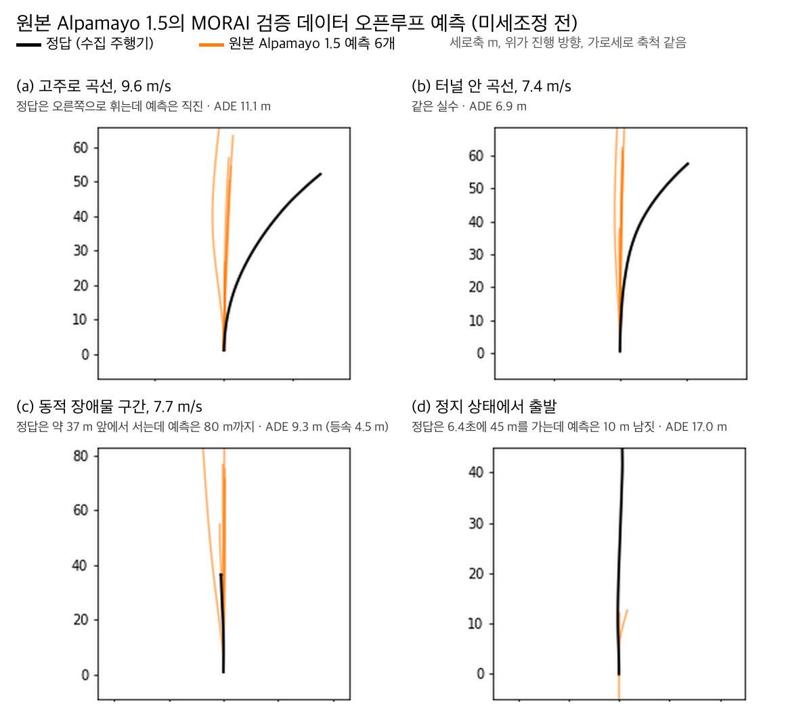

# [피지컬AI] 와우마요 개발기 (1)

NVIDIA의 Alpamayo 1.5를 작은 E2E 모델로 증류한다. 이름은 와우마요(WoWmayo)라고 붙였다. MORAI 시뮬레이터의 K-City에서 2026 대학생 AI·S/W 모빌리티 경진대회의 미션에 따라 주행하는 것을 목표로 했다. 대회에는 동아리의 룰베이스 ROS 스택으로 나갔지만... 이 연재는 동아리 ROS 스택 개발과 병행한 개인 연구의 기록이다.

> 관련 글
> - [[피지컬AI] Alpamayo-R1 논문 읽기](https://velog.io/@taeyun_kim/피지컬AI-논문-리뷰-Alpamayo-R1)
> - [[피지컬AI] AutoPi: 자율주행 VLA모델 개발하기](https://velog.io/@taeyun_kim/피지컬AI-AutoPi-자율주행-VLA모델-개발하기)
> - [2026 대학생 AI·S/W 모빌리티 경진대회 출전기](https://velog.io/@taeyun_kim/2026-ai-sw-mobility-competition)
> - [Lanelet2와 특권모델 개발](https://velog.io/@taeyun_kim/Lanelet2와-특권모델-개발)

이 편은 무엇을 왜 증류하는지, 원본 Alpamayo가 MORAI에서 얼마나 못하는지, 그리고 무엇으로 평가하는지를 정한다. 이후 편은 모두 이 정의 위에서 진행된다.

## 1. 목표와 제약

Alpamayo 1.5는 10B 모델이다. 카메라 4대에서 0.4초 동안 4장씩, ego 이력 1.6초, 내비게이션 텍스트를 받아 6.4초 궤적(10 Hz, 64점)을 낸다. AutoPi 글에 적었듯 Alpamayo-R1의 도로 시험은 RTX PRO 6000에서 1회 추론에 약 99 ms가 걸렸다. 내게 있는 건 RTX 5080(16 GB) 한 장이므로 이 환경에서 10hz로 동작하는 모델을 목표로 증류 하기로 했다.

크기만 문제가 아니다. Alpamayo는 Nvidia Physical AI dataset에서 실제 도로 영상으로 배웠지만, 내가 모델을 주행시키려는 환경은 MORAI라는 시뮬레이션의 아이오닉5이다. 모델은 시뮬레이터의 렌더링, 아이오닉5의 제원, 센서 스펙을 모르므로 이 도메인을 적응시키는 것부터 시작해야 할 것이었다.

MORAI 시뮬레이터의 아이오닉5. 와우마요가 몰아야 할 차다.

센서는 GPS 1개, IMU 1개, VLP16 LiDAR 1개, 카메라 최대 4대였다. 기존에 만들었던 룰베이스 ROS 스택과 같은 스펙을 공유했다.

### 지연 제약

| 항목 | 조건 |
| --- | --- |
| 추론 GPU | RTX 5080 (16 GB) |
| 목표 주기 | 10 Hz, 한 스텝 100 ms |
| 목표 지연 | p99 80 ms (설계 목표, 실측 아님) |
| 카메라 | 고정 3대 + 자유 1대(Cam7: 지붕 1.5 m, 위로 10°, 화각 90°, 640×480) |

## 2. 원본 Alpamayo의 도메인 격차

교사를 먼저 도메인 적응 시키기로 했다. 사실은 Alpamayo가 강력해 모델이니 만큼 시뮬레이션의 렌더링 이미지에 대해서도 어느정도 성능을 보여주지 않을까 기대했지만...

| | ADE (m) | FDE (m) |
|---|---|---|
| 등속 기준선 | 5.14 | 12.77 |
| 원본 Alpamayo 1.5 | 5.29 | 15.41 |

원본 Alpamayo는 아무것도 학습하지 않은 등속 직진보다도 못했다. 

미세조정 전 원본 Alpamayo 1.5의 예측. 검정이 정답, 주황이 예측 6개다.

미세조정한 교사가 이 숫자를 얼마나 줄였는지는 [4편](TODO)에서 다룬다.

## 3. 접근: 증류

교사를 먼저 MORAI에 적응시키고, 그 교사를 작은 학생에 증류한다.

- **교사 T\***: Alpamayo 1.5-10B에 LiDAR ViT를 붙이고 직접 모은 MORAI 데이터로 미세조정한 모델, 약 11.7B.
- **학생(와우마요)**: Qwen3-VL-4B에 Alpamayo의 action expert를 이식한 모델, 약 7.1B. 교사의 KV를 따라 배우고 교사의 action expert를 그대로 물려받는다. 그러니 교사가 먼저 MORAI를 알아야 했다.

증류로 맞추는 것은 궤적(행동), 층별 KV(특징), expert 가중치 세 가지다. 구조와 선택 근거는 [3편](TODO)에서 다룬다.

연재의 나머지 편은 이 접근을 따라간다.

| 편 | 다루는 질문 |
| --- | --- |
| [2편](TODO) 데이터 | 어떤 데이터와 어떤 정답으로 가르치는가 |
| [3편](TODO) 모델 설계 | 교사와 학생을 어떻게 짜고, 무엇을 증류하는가 |
| [4편](TODO) 교사 적응 | 교사를 MORAI에 어떻게 적응시켰고, 어떤 지표로 골랐는가 |
| [5편](TODO) 학생 증류와 경량화 | 학생을 어떻게 배웠고, 5080 10 Hz에 어떻게 올렸는가 |
| [6편](TODO) 폐루프 평가 | 실제로 달리면 어디서, 왜 실패하는가 |
| [7편](TODO) 데이터 보강과 미세조정 | 실패의 원인이 된 데이터 결손을 어떻게 메웠는가 |
| [8편](TODO) 정지 능력 | 동적 장애물 앞에서 서는 법을 왜 못 배웠고, 무엇을 고쳤는가 |
| [9편](TODO) 결과와 고찰 | 버전별로 무엇이 효과가 있었고, 무엇이 남았는가 |

## 4. 평가 지표

오프라인 평가는 검증 세트에서 6.4초 예측 궤적의 ADE·FDE를 쟀고, 지금 속도로 직진하는 등속 궤적을 기준선으로 삼았다. 체크포인트는 CE가 아니라 궤적 ADE로 골랐다. 이유는 [4편](TODO)에 있다.

폐루프 평가는 대회 방식대로 주행 시간 + 감점 + 복귀×15 s로 채점했다. 감점 규칙은 [출전기](https://velog.io/@taeyun_kim/2026-ai-sw-mobility-competition)와 같다. 추론이 100 ms를 넘긴 스텝의 비율(late)은 따로 기록했다. 평가 환경은 [6편](TODO)에서 다룬다.

## 마치며

원본 Alpamayo 1.5는 MORAI K-City에서 등속 직진보다 못했다(ADE 5.29 m 대 5.14 m). 그리고 10B라 RTX 5080 한 장의 10 Hz 예산에 맞지 않았다. 그래서 교사를 먼저 MORAI에 적응시킨 뒤 작은 학생으로 증류하는 두 단계로 문제를 나눴고, 오프라인 ADE와 폐루프 점수·late로 평가하기로 했다.

다음 편은 교사와 학생을 가르칠 데이터를 어떻게 모으고, 어떤 정답을 붙였는가를 다룬다.
