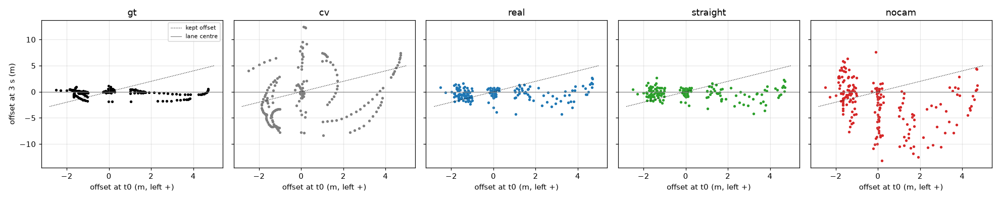
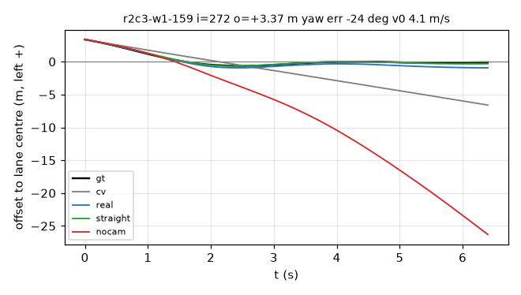
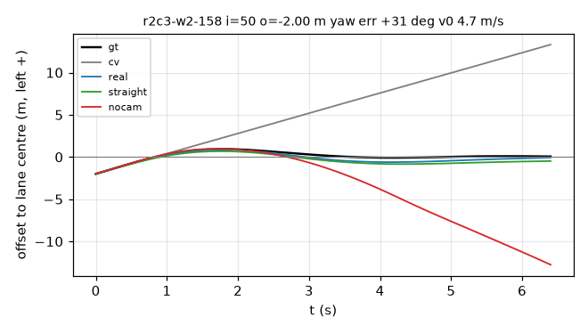

# 차선 인식 시험 (R2 ft 모델, 2026-10-28)

**판정:** 카메라로 차선을 봅니다. 이력에서 이탈 단서를 지워도(B) GT처럼 차로 중심으로 돌아옵니다. 카메라를 끄면(C) 복귀가 사라지고, 도로를 따라가지도 못합니다.

**DAgger 학습 부위에 주는 의미:** 차선 인식은 이미 LLM 특징에 있습니다. 그래서 복구 행동은 expert LoRA로 고칠 여지가 큽니다. 차선 때문에 LLM에 LoRA를 걸 근거는 없습니다. 다만 복귀 폭이 GT보다 작습니다(3 s 복귀율 중앙값 0.63 vs 0.81).

## 무엇을 쟀나
- **모델:** R2 미세조정 `ft/final`(BF16, QAD 전, B2 `runs/r2ft/ft/final`)
- **행:** R2 D(곡선 복구) 검증 장면이며, index의 split `val`이 8개 에피소드입니다.
  - 미세조정 검증 세트의 "곡선 R2 300행"과 장면이 같습니다. 다만 그 세트는 frame_stride 10에서 74행뿐이라, 여기서는 0.1 s 간격 행을 모두 썼습니다.
  - |이탈| ≥ 1 m인 행 전부와, 대조군으로 |이탈| < 0.3 m인 행 80개를 골랐습니다.
  - 카메라·LiDAR 프레임이 비는 48행은 데이터 로더가 뺐고, 198행이 남았습니다.
  - index 행은 미래 6.4 s에 노이즈 구간이 없는 행만 들어 있습니다(`r2_relabel_gaps.py`). 그래서 GT는 수집 주행기 자신의 복귀입니다.
- **이탈 o:** 경로 차로 중앙선까지의 부호 있는 횡거리입니다(왼쪽 +). 지도 대응은 `ft_synth_hist.project`와 같습니다. 예측과 GT의 2 s·3 s 위치도 같은 방법으로 잽니다.
- **조건:** 같은 행, 같은 초기 노이즈(seed = 행 번호)로 셋을 돌렸습니다.
  - (A) 실제 이력
  - (B) 곧은 이력: 현재 heading으로 v0 등속 직진
  - (C) (B) + 카메라 16장 검정(LiDAR는 유지)
  - 바뀌는 것은 이력 토큰뿐입니다. v0와 적분은 실제 이력에서 가져옵니다(`ft_measure`·배포와 같음).
- **기준선:** 현재 방향 직진. heading만으로 얼마나 돌아오는지를 봅니다.
- **지표:**
  - 복귀율 = 1 − |d(3 s)| / |o|. 1이면 중심에 도착, 0이면 이탈을 유지, 음수면 더 벗어난 것입니다.
  - 기울기 = d(3 s) − o를 o에 원점 회귀한 값입니다. −1이면 중심으로 복귀, 0이면 이탈 유지입니다.

## 결과
칸 형식: **복귀율 평균 / 중앙값 / 기울기 / 3 s 시점 |횡 위치|(m)**. 대조군 칸은 3 s 시점 |횡 위치|만 적었습니다.

| 조건 | 1–2 m | 2–3.5 m | 3.5 m 이상 | 1 m 이상 전체 | 대조군 < 0.3 m |
|---|---|---|---|---|---|
| GT (수집 주행기) | +0.68 / +0.79 / -0.90 / 0.43 | +0.69 / +0.86 / -1.31 / 0.87 | +0.83 / +0.89 / -1.12 / 0.65 | +0.70 / +0.81 / -1.08 / 0.51 | 0.25 |
| 기준: 현재 방향 직진 | -2.00 / -1.86 / +0.57 / 3.99 | -0.75 / -0.71 / -2.61 / 4.64 | +0.15 / +0.17 / -0.37 / 3.69 | -1.58 / -1.18 / -0.44 / 4.02 | 3.41 |
| (A) 실제 이력 | +0.39 / +0.48 / -0.80 / 0.83 | +0.49 / +0.66 / -1.47 / 1.41 | +0.69 / +0.74 / -0.93 / 1.28 | +0.44 / +0.53 / -0.98 / 0.96 | 0.55 |
| (B) 곧은 이력 | +0.48 / +0.59 / -0.95 / 0.73 | +0.52 / +0.70 / -1.44 / 1.33 | +0.70 / +0.82 / -1.02 / 1.20 | +0.51 / +0.63 / -1.07 / 0.86 | 0.50 |
| (C) 곧은 이력 + 카메라 검정 | -1.35 / -0.69 / -2.10 / 3.33 | -0.94 / -0.46 / -2.75 / 5.21 | +0.40 / +0.68 / -1.17 / 2.45 | -1.07 / -0.46 / -1.75 / 3.41 | 3.78 |
| 행 (에피소드) | 107 (6) | 15 (3) | 19 (2) | 141 (6) | 57 (7) |

t0 방향별로 나눈 1 m 이상 행입니다. 칸 형식: **복귀율 중앙값 / 3 s 시점 |횡 위치|(m)**

| 조건 | 차로 쪽 > 5° | 평행 ±5° | 바깥쪽 > 5° |
|---|---|---|---|
| GT (수집 주행기) | +0.85 / 0.52 | +0.82 / 0.34 | +0.43 / 0.82 |
| 기준: 현재 방향 직진 | -0.40 / 3.35 | -0.96 / 4.06 | -3.97 / 6.22 |
| (A) 실제 이력 | +0.64 / 0.98 | +0.52 / 0.83 | +0.14 / 1.12 |
| (B) 곧은 이력 | +0.70 / 0.94 | +0.59 / 0.80 | +0.57 / 0.69 |
| (C) 곧은 이력 + 카메라 검정 | -0.84 / 4.23 | -0.02 / 2.58 | -0.02 / 2.35 |
| 행 (에피소드) | 74 (6) | 45 (6) | 22 (3) |

- **(B) ≈ GT:** 1 m 이상 전체에서 기울기는 −1.07로 GT −1.08과 같고, 복귀율 중앙값은 0.63(GT 0.81)입니다.
  - 현재 방향으로 직진하면 3 s에 4.0 m 벗어나는데, 모델은 0.86 m입니다. 차로와 평행하거나 바깥을 향한 행에서도 돌아옵니다(0.59, 0.57). heading의 연장이 아니라 실제로 조향해서 돌아오는 것입니다.
- **(A)와 (B)의 차이는 작습니다.** 실제 이력이 오히려 조금 나쁩니다(바깥을 향한 행 0.14 vs 0.57). 모델은 이력이 아니라 카메라로 차로를 판단합니다.
- **(C)는 무너집니다.** 대조군(중심에서 출발)도 3 s에 3.8 m 벗어납니다. LiDAR만으로는 도로를 따라가지 못합니다. 카메라가 차선과 도로 인식을 맡고 있습니다.
- **GT보다 약한 점:**
  - 복귀율이 GT보다 0.2 정도 낮습니다.
  - 대조군에서도 3 s에 0.50 m가 벗어납니다(GT 0.25).
  - 점이 GT보다 넓게 흩어집니다. 평균으로는 중심으로 가지만, 행마다 오차가 큽니다(아래 산점도).

## 그림
- 3 s 시점 횡 위치 대 t0 이탈 (조건별): 
- 3.37 m 이탈, 차로 쪽 −24°: (A)·(B)는 GT와 겹치고, (C)는 도로를 벗어납니다. 
- −2.0 m 이탈, +31°: (B)는 GT보다 조금 덜 돌아옵니다. 

## 한계
- 검증 장면이 적습니다. 2 m 이상 구간은 에피소드 2–3개입니다. 0.1 s 간격 행은 서로 비슷해서 실제 표본 수는 행 수보다 훨씬 적습니다. 1–2 m 구간(6개 에피소드)이 판정의 주 근거입니다.
- GT는 속도·방향을 적분한 궤적입니다(학습 정답과 같은 방식). 실제 위치와는 3 s에 평균 0.11 m(p90 0.23 m) 다릅니다.
- 계획(궤적)만 봤습니다. 폐루프에서 추종 지연(약 0.3 s, 7–12 m/s에서 86 %만 꺾임)이 더해지면 실제 복귀는 더 약할 수 있습니다.

## 재현
```bash
python scripts/lane_test.py select --root <R2 _index + _ego> --out sel.parquet
python scripts/lane_test.py run --root <step0_r2> --sel sel.parquet --ckpt <ft/final> --out <dir>
python scripts/lane_test.py report --ego <step0_r2>/_ego --sel sel.parquet --preds <dir>/preds.npz --out <dir>
```
- 결과: B2 `runs/r2ft/lane_test/`(preds.npz, sel.parquet, run.log, box.log)
- 표: `reports/lane_test/summary.json`

## 상자·비용
- vast RTX 5090 1장, 핀란드, 인스턴스 58015052, $0.633/h(청구 기준). s2 특징 추출(신호 프로브)도 같은 상자에서 했습니다.
- 차선 시험 몫은 06:29–06:42(약 13분)이고 약 $0.2입니다. 받기 6.5분, 추론 3분(198행 × 3조건, 행당 1.0 s)이 들었습니다.
- 상자 전체 청구는 $0.39입니다(GPU 0.20, 저장 0.06, 받기 0.13).
  - 06:50에 정지했고, 08:15에 삭제했습니다.
  - 삭제 전에 B2 `runs/r2ft/lane_test/` 6개 파일을 확인했습니다. 정지해 둔 사이 GPU를 다른 사람이 가져가 접속할 수 없었기 때문에 `safe_destroy.sh` FORCE=1로 지웠습니다.
  - `vastai show instances`에서 사라진 것을 확인했습니다.
- 다른 상자 비용은 `reports/signal_probe_20261028.md`에 있습니다.
