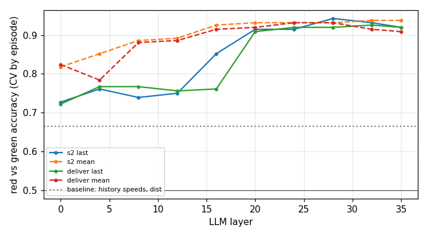
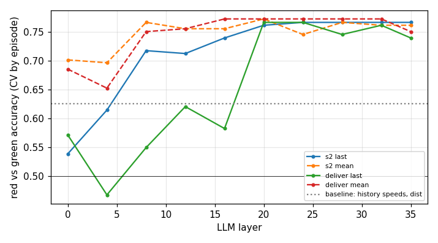

# 신호 인식 특징 프로브 (s2 vs R2 납품본, 2026-10-28)

**판정:** 인식은 남았고 행동만 약해졌습니다. 납품본 LLM 특징으로 적신호와 녹색을 가리는 정확도는 s2와 같습니다(후반 층 0.92–0.93 vs 0.92–0.94). 정지율이 떨어지는 곳은 달리다가 적신호를 만나는 행뿐입니다(0.95 → 0.86).

## 무엇을 쟀나
- **모델**
  - s2 final(BF16, B2 `runs/stageC/s2/final`)
  - R2 미세조정 납품본(B2 `runs/r2ft/deliver/final`). QAD 가짜 양자화를 유지한 채, 관문과 같은 `StudentVLA.build(init=…)`로 읽었습니다. modelopt FP8 확장은 ninja로 빌드됐습니다.
- **특징:** CoC 없는 배포 프리픽스(`<traj_future_start>`로 끝남)의 LLM 프리필에서 뽑았습니다.
  - 층: 0, 4, …, 32, 35(36층 전부를 expert가 읽음)
  - 풀링 둘: 마지막 토큰, 프리픽스 평균
- **프로브:** L2 로지스틱 회귀로 적신호 대 녹색을 맞힙니다.
  - 에피소드 단위 5겹 교차검증이라, 한 에피소드가 학습과 평가에 같이 들어가지 않습니다.
  - L2 가중치는 학습 몫 안에서 다시 에피소드 단위로 나눠 고릅니다.
- **기준선:** 같은 프로브를 프리픽스에 담긴 움직임 정보, 즉 속도 4개(t0, −0.5 s, −1.0 s, −1.5 s)와 정지선까지 거리에만 돌렸습니다.
  - `_ego`의 가속도 `a`는 앞뒤 0.2 s로 평활한 값이라 미래가 섞여 있어 넣지 않았습니다. 넣으면 기준선이 0.87로 부풉니다.
- **행:** R1 val + val_asset에서 판정 정지선 10–60 m 앞, 신호 1(적) 또는 3(녹)인 행입니다. 세트는 둘입니다.
  - **혼합 세트(요청안):** 적·녹 91행씩, 에피소드 55개, 행 간격 0.5 s 이상. 정지선·거리 10 m 구간·속도 구간을 맞췄습니다. 실행된 행은 176개입니다(프레임 공백으로 6행 빠짐).
  - **정지 짝 세트(교란 제거용으로 추가):** 이력 1.5 s 내내 서 있는 행만 씁니다. 같은 정지 사건에서 녹색으로 바뀐 직후(아직 출발 전)의 행과 그 1–3 s 전 적신호 행을 짝지었습니다. 위치·거리·이력·장면이 같고 신호색만 다릅니다. 95행씩, 에피소드 40개이고 실행된 행은 184개입니다.
  - 이 세트를 따로 둔 이유: 혼합 세트의 적신호 행은 대부분 서 있거나 감속 중이라, 프로브가 신호 대신 속도를 읽을 수 있습니다.
- **정지율:** 같은 행에서 같은 초기 노이즈로 낸 계획의 6.4 s 끝 속도가 3 m/s 이하인 비율입니다.

## 층별 정확도 (마지막 토큰 / 프리픽스 평균)
| LLM 층 | 혼합: s2 | 혼합: 납품본 | 정지 짝: s2 | 정지 짝: 납품본 |
|---|---|---|---|---|
| 0 | 0.73 / 0.82 | 0.72 / 0.82 | 0.54 / 0.70 | 0.57 / 0.69 |
| 4 | 0.76 / 0.85 | 0.77 / 0.78 | 0.61 / 0.70 | 0.47 / 0.65 |
| 8 | 0.74 / 0.89 | 0.77 / 0.88 | 0.72 / 0.77 | 0.55 / 0.75 |
| 12 | 0.75 / 0.89 | 0.76 / 0.89 | 0.71 / 0.76 | 0.62 / 0.76 |
| 16 | 0.85 / 0.93 | 0.76 / 0.92 | 0.74 / 0.76 | 0.58 / 0.77 |
| 20 | 0.92 / 0.93 | 0.91 / 0.92 | 0.76 / 0.77 | 0.77 / 0.77 |
| 24 | 0.92 / 0.93 | 0.92 / 0.93 | 0.77 / 0.74 | 0.77 / 0.77 |
| 28 | 0.94 / 0.93 | 0.92 / 0.93 | 0.77 / 0.77 | 0.74 / 0.77 |
| 32 | 0.93 / 0.94 | 0.93 / 0.92 | 0.77 / 0.76 | 0.76 / 0.77 |
| 35 | 0.92 / 0.94 | 0.92 / 0.91 | 0.77 / 0.76 | 0.74 / 0.75 |
| 기준선 (이력 속도 4개 + 거리) | 0.67 | | 0.62 | |

- **두 세트 모두 후반 층(20–35)에서 두 모델의 정확도가 같습니다.** 차이는 ±0.02 이내이고, 행 약 180개의 표준오차(약 0.03)보다 작습니다.
- 정지 짝 세트는 더 어렵지만(0.77), 기준선 0.62보다 높습니다. 신호색만 다른 장면에서도 신호를 읽고 있습니다.
- 납품본은 정지 짝 세트에서 4–16층 마지막 토큰 정확도가 낮습니다(0.47–0.62, s2 0.61–0.74). 프리픽스 평균이나 20층 이후에서는 같아서, 정보가 사라진 것은 아닙니다.
- 그림:  

## 정지율 (혼합 세트, 속도 구간별)
| 적신호 행 | 행 (에피소드) | GT | s2 | 납품본 |
|---|---|---|---|---|
| 서 있음 (< 0.5 m/s) | 56 (31) | 0.95 | 0.96 | 0.95 |
| 느림 (0.5–4 m/s) | 11 (9) | 0.91 | 1.00 | 1.00 |
| **달림 (> 4 m/s)** | 22 (18) | 1.00 | **0.95** | **0.86** |
| 전체 | 89 | 0.96 | 0.97 | 0.93 |

- 녹색 행 전체의 정지율(잘못 섬)은 s2 0.13, 납품본 0.09입니다. GT는 0.01입니다.
- 정지 짝 세트의 정지율은 두 모델이 같습니다. 적신호에서 s2 0.98, 납품본 0.99이고, 녹색 직후에서 s2 0.44, 납품본 0.48입니다. GT는 둘 다 6.4 s 안에 출발합니다.
- 회귀 분석(`reports/r2ft_regression_analysis.md`)에서 서지 못한 사례는 달리다가 감속해야 하는 행이었습니다. 여기서도 그 구간에서만 정지율이 떨어집니다. 다만 22행뿐이라 2행 차이입니다.

## 해석
- R2 데이터에 적신호가 0행이라 생긴 문제는 인식 손상이 아닙니다. "적신호를 보면 감속한다"는 행동이 약해진 것입니다.
- 다음 미세조정이나 DAgger에서 신호 정지 행(R1 신호 1 감속·정지 행)을 다시 넣는 처방이 맞습니다. 신호 인식을 위해 LLM에 LoRA를 걸 근거는 없습니다.

## 한계
- 선형 프로브는 정보가 남았는지만 봅니다. expert가 그 정보를 쓰는지는 보지 않습니다. 쓰는지는 정지율과 폐루프로 봐야 합니다.
- 정지율 표에서 달리는 적신호 행은 22행입니다. 교차로 앞 정지 전체를 보려면 회귀 분석의 일반 검증 1,000행 기록이 더 큽니다.
- 신호 코드 1 = 적신호는 자료로 추정한 것입니다(회귀 분석과 같음). 4356의 화살표 신호는 구분하지 않습니다.

## 재현
```bash
python scripts/signal_probe.py select --root <R1 _index + _ego> --n-eps 60 --gap 5 --out sigrows_mixed.parquet
python scripts/signal_probe.py select --root <R1 _index + _ego> --stationary --eps sig_eps.txt --out sigrows_stat.parquet
python scripts/signal_probe.py run --root <step0> --rows <rows> --ckpt <s2/final | deliver/final> --tag s2|deliver --out <dir>
python scripts/signal_probe.py probe --rows <rows> --feats <dir>/feats_s2.npz <dir>/feats_deliver.npz --out <dir>
```
- 결과: B2 `runs/r2ft/signal_probe/`(혼합)와 `runs/r2ft/signal_probe/stationary/`. 특징(npz), rows.parquet, probe.json, 로그가 들어 있습니다.
- QAD 납품본을 상자에서 읽으려면 `python3.12-dev`, `build-essential`, `ninja-build`가 필요합니다(triton, modelopt FP8 확장 빌드).

## 상자·비용 (vast 청구 기준)
| 상자 | 용도 | 청구 | 처리 |
|---|---|---|---|
| 58015052 RTX 5090, 핀란드, $0.633/h | 차선 시험 + s2 특징(혼합) | $0.39 (GPU 0.20, 저장 0.06, 받기 0.13) | 06:50 정지. 정지해 둔 사이 GPU를 다른 사람이 가져가 08:15 삭제(결과는 모두 B2에 있음, FORCE) |
| 58023918 RTX 5090, 일본, $0.655/h | 신호 프로브 1차 | $0.07 | DNS 고장(github·pypi 접속 불가), 실행 전 삭제(FORCE) |
| 58024452 RTX 5090, 헝가리, $0.748/h | 신호 프로브 | $0.45 (GPU 0.30, 받기 0.13) | 08:47 `safe_destroy.sh`로 삭제(B2 20개 파일 확인 뒤) |
| **합계** | | **$0.91** | 세 상자 모두 삭제 확인(`vastai show instances`) |

- 신호 프로브 몫은 약 $0.7입니다. 목표 $0.5는 넘었지만 상한 $2 안입니다. 넘은 이유는 상자를 다시 빌린 것(GPU 유실, DNS 고장)입니다.
